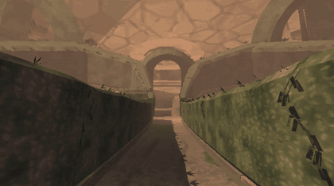
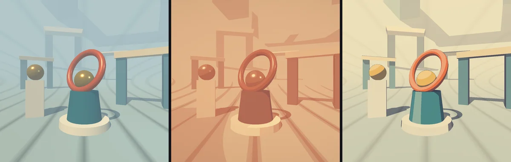

# Glome

An $S^3$ non-Euclidean geometry engine for Godot 4.7 (.NET, Vulkan compute).

<p align="center">
  
  <br />
  <sub>Captured in <em>Absent Sky</em>, a game built with Glome.</sub>
</p>

## Getting Started

Installation, quick start, authoring guides, and the Set 0 compute ABI reference live on the documentation site: **[glome.sworld.club](https://glome.sworld.club/)** ([中文文档](https://glome.sworld.club/zh-cn/)).

<p align="center">
  
  <br />
  <sub><a href="addons/glome/Shaders/glome_standard.glsl"><code>glome_standard.glsl</code></a> / <a href="tests/standalone/grade.gdshader"><code>grade.gdshader</code></a> / <a href="tests/standalone/cel.glsl"><code>cel.glsl</code></a></sub>
</p>

## Development

**Requirements**

- **.NET 10 SDK** for `Glome.Core` unit tests
- **Godot 4.7.1 (.NET)**, matching export templates, and **Python 3.12** for Windows end-to-end add-on verification
- **Node.js** and **pnpm** for building and checking `site/`

**Tests**

```bash
# Pure-C# math, BVH, collision, and acoustic unit tests
dotnet test tests/Glome.Core.Tests/Glome.Core.Tests.csproj

# End-to-end Godot + Vulkan + export verification (Windows)
python tests/verify_standalone_addon.py --godot /path/to/Godot_v4.7.1-stable_mono_console

# Documentation design contract, build, and API/ABI sync checks
node scripts/check_design_contract.mjs && pnpm --dir site build && node scripts/check_docs_sync.mjs
```
